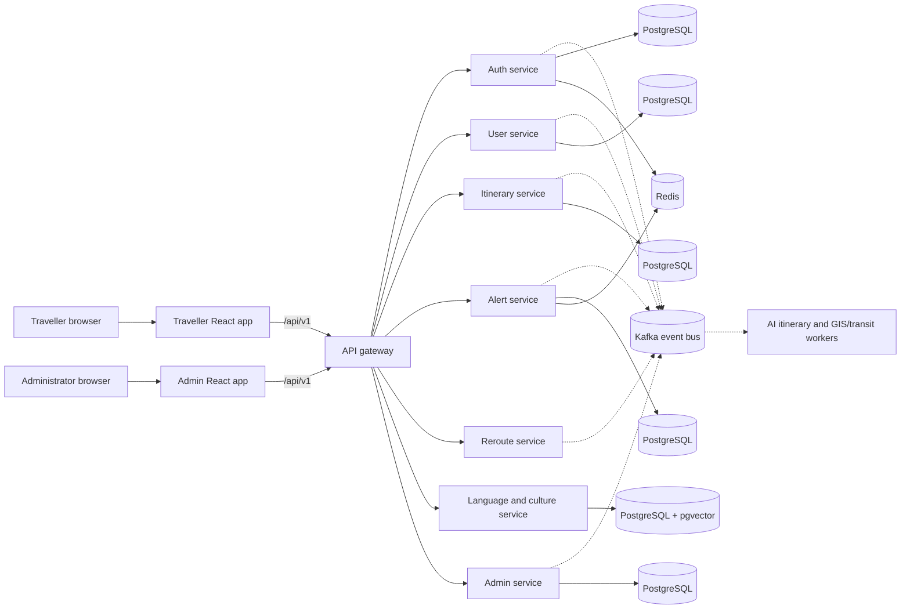

# Karnataka Travel AI

Karnataka Travel AI is a travel-planning platform composed of a traveller-facing web app, an administrator dashboard, and a TypeScript microservice backend. It supports trip planning, Kannada language and cultural assistance, travel disruption alerts, itinerary rerouting, and operational administration.

## Project applications

| Application | Directory | Purpose |
|---|---|---|
| Traveller web app | [`karnataka-travel-ai-web/`](./karnataka-travel-ai-web/) | Registration and sign-in, trip planning, itinerary progress and editing, alerts, profile preferences, and Kannada cultural and voice assistance. |
| Admin dashboard | [`karnataka-travel-ai-admin-web/`](./karnataka-travel-ai-admin-web/) | Admin-only tools for overview, users, trips, disruptions, operations, notifications, and audit history. |
| Backend | [`karnataka-travel-ai-backend/`](./karnataka-travel-ai-backend/) | API gateway, domain services, background workers, shared packages, event contracts, and local infrastructure. |

## Architecture



The browser applications make same-origin requests to `/api/v1`. In production, the hosting platform must route `/api/*` to the public API gateway over HTTPS. The gateway applies rate limiting, CORS, security headers, token introspection, and circuit breakers before proxying to the relevant service; service-level middleware enforces route permissions. Services use Kafka for asynchronous work and read models; the AI itinerary and GIS/transit workers consume and publish events.

## Application capabilities

### Traveller web app

- Account registration, login, session restoration, and profile preferences.
- Itinerary generation, trip listing and details, progress updates, and day/activity reordering.
- Live itinerary progress and travel advisories over Server-Sent Events (SSE), with polling while generation is in progress.
- Disruption alternatives and traveller acceptance or dismissal of reroute proposals.
- Cultural guidance and English/Kannada voice translation.
- OpenStreetMap-based maps using Leaflet.

The frontend keeps its access token in memory and uses an HttpOnly refresh cookie. Voice input records audio in the browser and submits it to the backend; a Whisper-compatible service is required for server transcription. Server-side speech output is optional; the browser can use speech synthesis as a fallback.

### Admin dashboard

- Admin-only login and overview.
- Traveller lookup, account suspension/reactivation, trip details, and disruption listings.
- Service health checks, disruption scans, administrative notifications, and audit history.

The dashboard sends the `X-Client: admin` header so authentication can use a separate admin refresh cookie and reject non-admin accounts. Restrict access to this application with the deployment platform's access controls, VPN, or an IP allow-list where practical.

### Backend services

| Service or worker | Responsibility |
|---|---|
| `api-gateway` | Public API entry point, request limits, authentication introspection, and routing to backend services. |
| `auth-service` | Login, refresh/logout, JWT verification, and initial administrator seeding. |
| `user-service` | Registration, profile, and user preferences. |
| `itinerary-service` | Trip requests, itinerary retrieval/reordering, and SSE progress stream. |
| `ai-itinerary-worker` | Asynchronous itinerary generation. |
| `gis-transit-worker` | Route-leg and transit calculations. |
| `alert-service` | Disruption monitoring, alerts, and notification dispatch. |
| `reroute-service` | Alternative itinerary proposals and accepted/dismissed reroute changes. |
| `language-culture-service` | Voice translation and retrieval-based cultural guidance. |
| `admin-service` | Admin overview, user/trip operations, service health, and audit read models. |

## API route overview

All routes below are under `/api/v1` at the gateway. Most routes require a valid session; registration, login, and refresh are public. Admin routes require an authenticated `ADMIN` role.

| Route | Purpose |
|---|---|
| `POST /users/register` | Register a traveller. |
| `POST /auth/login`, `/auth/refresh-token`, `/auth/logout` | Create, refresh, or end a session. |
| `GET /users/me`, `PUT /users/me/preferences` | Read a profile and update preferences. |
| `GET /itineraries`, `POST /itineraries/generate`, `GET /itineraries/:id` | List, request, or retrieve itineraries. |
| `GET /itineraries/stream` | Receive itinerary progress and trip events over SSE. |
| `PUT /itineraries/:id/reorder` | Reorder itinerary activities. |
| `GET /alerts/mine` | Retrieve the signed-in traveller's alerts. |
| `GET /reroute/alternatives/:tripId`, `POST /reroute/modify-active-trip` | Retrieve and act on reroute proposals. |
| `POST /language/translate-voice`, `POST /language/cultural-guide` | Translate text/audio or request cultural guidance. |
| `/admin/*` | Admin overview, users, trips, disruptions, operations, notifications, and audit history. |

`GET /health` on the gateway confirms that the gateway process is responding; it does not prove that its upstream services or their databases are healthy. The admin operations health route provides additional service checks.

## Requirements

- Node.js 20 or later and npm. For the Vite applications, use a current supported Node 20 release (20.19 or later) or Node 22.12 or later.
- Docker Desktop with Docker Compose for the complete local backend stack.
- Provider credentials only for integrations you intend to use (for example Gemini, Whisper, Google Text-to-Speech, Kafka, SMTP, or WhatsApp).

## Local development

Run each project setup snippet from the workspace root in its own terminal, or return to the workspace root before switching projects.

### Backend and local infrastructure

```powershell
cd karnataka-travel-ai-backend
Copy-Item .env.example .env
npm ci
```

Review `.env` and set unique local secrets before starting the services. The Compose stack supplies local PostgreSQL/pgvector, Redis, and Redpanda/Kafka. Start the stack with:

```powershell
docker compose up --build
```

The API gateway is exposed at `http://localhost:8080`; the traveller app container is exposed at `http://localhost:4173`. The Vite development servers use port `5173` for the traveller app and `5174` for the admin app. Local observability endpoints include Grafana at `http://localhost:3001`, Prometheus at `http://localhost:9090`, and Jaeger at `http://localhost:16686`. Internal service ports and infrastructure are intended to remain on the Compose network.

PostgreSQL initialization and service schemas are managed by the backend SQL migrations and startup code. For a hosted database, configure a valid `DATABASE_URL` for each service. The application is structured around service-owned data; use isolated databases or an explicitly designed equivalent when deploying services to a shared database provider. The language/culture service requires PostgreSQL with the `pgvector` extension.

### Traveller web app

```powershell
cd karnataka-travel-ai-web
npm ci
```

Set `VITE_API_PROXY` in the app's local `.env` to the gateway being used for development, for example `http://localhost:8080`, then run:

```powershell
npm run dev
npm run build
```

The Vite development proxy forwards `/api` to `VITE_API_PROXY`, keeping refresh-cookie requests same-origin in the browser.

### Admin dashboard

```powershell
cd karnataka-travel-ai-admin-web
npm ci
```

Set `VITE_API_PROXY` to the same reachable gateway, then run:

```powershell
npm run dev
npm run build
```

The admin app is not included in the backend Compose stack; run it separately during local development or deploy it as its own static web application.

## Backend builds

From `karnataka-travel-ai-backend`, the root `npm run build` compiles shared packages and the gateway, auth, user, itinerary, and alert services. It does **not** currently build every workspace. Build the remaining workspaces explicitly when preparing those services or workers:

```powershell
npm run build
npm run build -w @kta/reroute-service
npm run build -w @kta/language-culture-service
npm run build -w @kta/admin-service
npm run build -w @kta/ai-itinerary-worker
npm run build -w @kta/gis-transit-worker
```

Each backend workspace also provides a `dev` script for running its TypeScript entry point with `tsx`. The generic backend Dockerfile runs the root build script, so build targets omitted from that script must be built as part of the image build before using that image for those services.

## Configuration and integrations

Use the backend [`.env.example`](./karnataka-travel-ai-backend/.env.example) as the variable reference. Never commit `.env` files or put backend credentials in either web app: all `VITE_*` values are exposed to the browser.

| Configuration | Used for |
|---|---|
| `DATABASE_URL` | PostgreSQL connection for each backend service. |
| `INTERNAL_API_KEY` | Shared secret for gateway-to-service trust; use a high-entropy value of at least 16 characters. |
| `JWT_ACCESS_SECRET`, `JWT_REFRESH_SECRET` | Auth signing secrets; configure distinct high-entropy values of at least 32 characters. |
| `ADMIN_EMAIL`, `ADMIN_PASSWORD` | Optional initial administrator seed values read by `auth-service` on startup. |
| `CORS_ORIGIN` | Comma-separated browser origin allow-list for the gateway. |
| `KAFKA_BROKERS` (or `KAFKA_BROKER`) | Kafka broker list. For hosted TLS/SASL brokers, configure `KAFKA_SSL`, `KAFKA_USERNAME`, `KAFKA_PASSWORD`, and `KAFKA_SASL_MECHANISM` as required. |
| `KAFKA_CA_CERT_BASE64` | Optional base64-encoded PEM CA certificate bundle for brokers using a non-public CA. Certificate verification remains enabled. |
| `REDIS_URL` | Redis connection for services/workers that use Redis. Use the provider's TLS URL when required. |
| `GEMINI_API_KEY`, `GEMINI_MODEL` | Gemini-backed itinerary, translation, or cultural features that use the configured model. |
| `WHISPER_API_KEY`, `WHISPER_BASE_URL`, `WHISPER_MODEL` | OpenAI-compatible speech-to-text provider for voice input. |
| `GOOGLE_TTS_API_KEY` | Optional server-side text-to-speech. |
| `SMTP_*`, `WHATSAPP_*` | Optional email and WhatsApp notification providers. |
| `VITE_API_PROXY` | Development-only Vite proxy target; it is not the production Vercel rewrite setting. |

### Creating the first administrator

There is no public admin registration endpoint. Set `ADMIN_EMAIL` and `ADMIN_PASSWORD` in the **auth-service's backend environment** before its first startup. The auth service creates an `ADMIN` account if that email is not already present. If an account with the same email already exists, startup does not promote or reset it. Use a new, dedicated administrator email and a strong password; remove or rotate the seed credentials after the account is provisioned.

### Gemini and voice features

Create and manage the Gemini API key with Google AI Studio, then store it only in the backend secret configuration. Set `GEMINI_MODEL` to a model available to the Google account and enabled for the project's API. Translation may not work when the key is missing, invalid, quota-limited, or the chosen model is unavailable.

Voice transcription requires a compatible Whisper API endpoint and key. Google Text-to-Speech is optional; when server audio is unavailable, the traveller app can fall back to browser speech synthesis.

## Deployment

The project has been configured around separate Vercel projects for the two web apps and a backend API gateway hosted separately. The deployment addresses supplied for this project are:

- Traveller app: <https://kannada-digital-innovation.vercel.app/>
- Admin dashboard: <https://kannada-digital-innovation-yrqz.vercel.app/>
- API gateway: <https://karnataka-api-gateway.onrender.com/>

These URLs identify the intended deployments; they do not by themselves confirm that every backend service is healthy.

### Vercel

Create one Vercel project per frontend, using the corresponding app directory as its project root. Use the standard Vite build command (`npm run build`) and output directory (`dist`). The production API route is controlled by each app's `vercel.json`; `VITE_API_PROXY` is for local Vite development only.

**Before deploying, update and verify both `vercel.json` files.** In the current workspace, their `/api/:path*` rewrites target an HTTP IP address (`http://98.88.252.31:4000`) instead of the HTTPS gateway URL above. Replace that destination with the currently deployed HTTPS API gateway and confirm that `/api/*` paths are preserved. Do not use the HTTP IP target for a production deployment.

### Backend hosting

Deploy the gateway and each upstream service/worker as reachable backend processes or containers. Configure the gateway's `AUTH_SERVICE_URL`, `USER_SERVICE_URL`, `ITINERARY_SERVICE_URL`, `ALERT_SERVICE_URL`, `REROUTE_SERVICE_URL`, `LANGUAGE_SERVICE_URL`, and `ADMIN_SERVICE_URL` to the corresponding service URLs. These settings are required for gateway routing; a healthy gateway alone cannot serve application requests when an upstream is missing or unreachable.

Configure production database, Kafka, Redis, AI, notification, and security settings in the backend hosting provider's secret/environment management. Set `CORS_ORIGIN` to the exact browser origins where direct cross-origin requests are used. Use HTTPS at the public ingress and set auth cookie security options appropriately for production. Do not expose internal service URLs, databases, Redis, or Kafka directly to the public internet.

## Security and operational notes

- Treat all credentials, API keys, database URLs, and signing secrets as secrets. Rotate any credential that has been pasted into a public or shared conversation.
- Frontend environment variables are public once bundled. Keep Gemini, Whisper, database, Kafka, Redis, JWT, SMTP, and WhatsApp credentials on the backend only.
- The gateway removes externally supplied identity headers and injects identity only after token verification. Backend services also require the internal gateway key.
- Keep the admin dashboard restricted to trusted administrators and use HTTPS for the dashboard, gateway, and cookie-based sessions.
- The optional traveller disruption simulation is hidden unless the frontend demo flag and backend `ENABLE_DEMO_ENDPOINTS=true` are both enabled. Do not enable demo endpoints unintentionally in production.
- OpenStreetMap tiles do not require an application token, but production traffic must comply with the provider's tile usage policy.
- Local Compose defaults and `.env.example` values are for development; replace credentials and provider settings before deployment.

## Known implementation boundaries

- Offline maps and itinerary caching are not implemented. The service worker caches the application shell, not API responses.
- A stored Kannada UI preference does not itself translate the entire interface.
- Automated test scripts are not defined in the current package manifests; use the build commands above as a compile/bundle check and add focused tests as the code evolves.
- The root backend build script currently covers only a subset of services and workers; see [Backend builds](#backend-builds) before building container images for omitted workspaces.